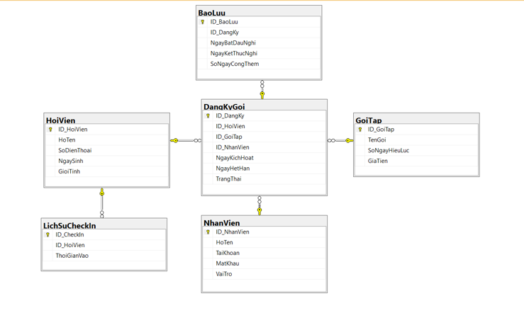

# Thiết kế Cơ sở dữ liệu

# Database Design Documentation - Hệ thống Quản lý Hội viên Phòng Gym/Yoga

## 1. Sơ đồ thực thể liên kết (ERD)

## 2. Chi tiết các bảng (Table Schema)

### 2.1 Bảng `employees` (Nhân viên)

| Cột             | Kiểu dữ liệu | Ràng buộc          | Mô tả                            |
| :-------------- | :----------- | :----------------- | :------------------------------- |
| `id`            | INT          | PK, Auto Increment | Mã nhân viên                     |
| `email`         | VARCHAR(100) | Unique, Not Null   | Email dùng để đăng nhập          |
| `password_hash` | VARCHAR(255) | Not Null           | Mật khẩu đã được băm bằng BCrypt |
| `full_name`     | VARCHAR(100) | Not Null           | Họ và tên nhân viên              |
| `role`          | VARCHAR(50)  | Not Null           | Vai trò (Admin, Receptionist)    |

### 2.2 Bảng `members` (Hội viên)

| Cột            | Kiểu dữ liệu | Ràng buộc          | Mô tả                            |
| :------------- | :----------- | :----------------- | :------------------------------- |
| `id`           | INT          | PK, Auto Increment | Mã hội viên                      |
| `full_name`    | VARCHAR(100) | Not Null           | Họ và tên                        |
| `phone_number` | VARCHAR(15)  | Unique, Not Null   | Số điện thoại (Dùng để check-in) |
| `dob`          | DATE         | Nullable           | Ngày sinh                        |
| `gender`       | VARCHAR(10)  | Nullable           | Giới tính                        |
| `address`      | VARCHAR(255) | Nullable           | Địa chỉ                          |
| `join_date`    | DATETIME     | Default GetDate()  | Ngày tạo hồ sơ đăng ký           |

### 2.3 Bảng `packages` (Gói tập)

| Cột                | Kiểu dữ liệu  | Ràng buộc          | Mô tả                                                |
| :----------------- | :------------ | :----------------- | :--------------------------------------------------- |
| `id`               | INT           | PK, Auto Increment | Mã gói tập                                           |
| `name`             | VARCHAR(100)  | Not Null           | Tên gói (VD: Gym 1 Tháng, Yoga 1 Năm)                |
| `duration_in_days` | INT           | Not Null           | Số ngày hiệu lực (Rất quan trọng cho logic tính hạn) |
| `price`            | DECIMAL(12,2) | Not Null           | Giá tiền                                             |

### 2.4 Bảng `subscriptions` (Đăng ký gói / Giao dịch)

| Cột           | Kiểu dữ liệu | Ràng buộc          | Mô tả                                       |
| :------------ | :----------- | :----------------- | :------------------------------------------ |
| `id`          | INT          | PK, Auto Increment | Mã giao dịch/Mã thẻ                         |
| `member_id`   | INT          | FK (members.id)    | Người mua thẻ                               |
| `package_id`  | INT          | FK (packages.id)   | Gói được mua                                |
| `employee_id` | INT          | FK (employees.id)  | Nhân viên thực hiện bán gói                 |
| `start_date`  | DATETIME     | Not Null           | Ngày kích hoạt (Bắt đầu tính thời gian tập) |
| `end_date`    | DATETIME     | Not Null           | Ngày hết hạn (Hệ thống tự động tính toán)   |
| `status`      | VARCHAR(50)  | Not Null           | Trạng thái (Active, Expired, Frozen)        |

### 2.5 Bảng `checkin_logs` (Lịch sử Check-in)

| Cột            | Kiểu dữ liệu | Ràng buộc          | Mô tả               |
| :------------- | :----------- | :----------------- | :------------------ |
| `id`           | INT          | PK, Auto Increment | Mã lượt check-in    |
| `member_id`    | INT          | FK (members.id)    | Khách hàng check-in |
| `checkin_time` | DATETIME     | Default GetDate()  | Ngày giờ khách đến  |

### 2.6 Bảng `freeze_logs` (Lịch sử Bảo lưu)

| Cột               | Kiểu dữ liệu | Ràng buộc             | Mô tả                                     |
| :---------------- | :----------- | :-------------------- | :---------------------------------------- |
| `id`              | INT          | PK, Auto Increment    | Mã bảo lưu                                |
| `subscription_id` | INT          | FK (subscriptions.id) | Khóa ngoại liên kết với thẻ tập đang dùng |
| `start_date`      | DATETIME     | Not Null              | Ngày bắt đầu nghỉ                         |
| `end_date`        | DATETIME     | Not Null              | Ngày kết thúc nghỉ                        |
| `extra_days`      | INT          | Nullable              | Số ngày được hệ thống tự động cộng bù     |

## 3. Quy ước đặt tên

- Tên bảng: `snake_case`, số nhiều (VD: `members`, `subscriptions`).
- Khóa chính: `id`.
- Khóa ngoại: `[tên_bảng_số_ít]_id` (VD: `member_id`, `package_id`).
